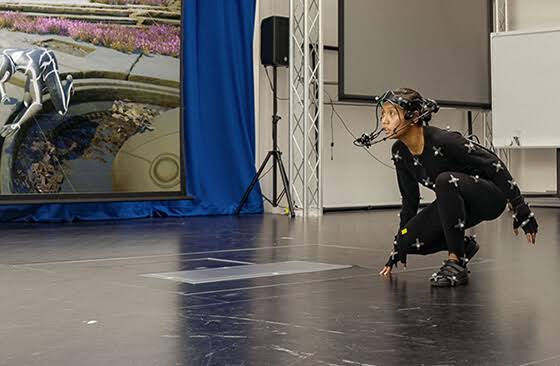
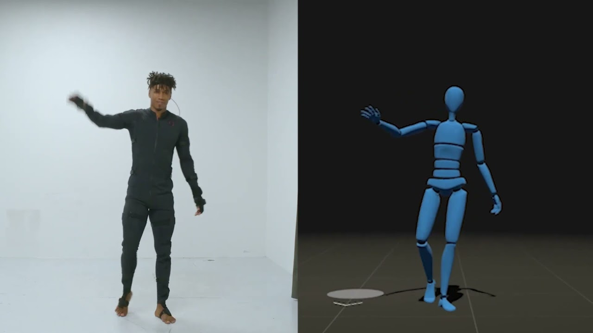
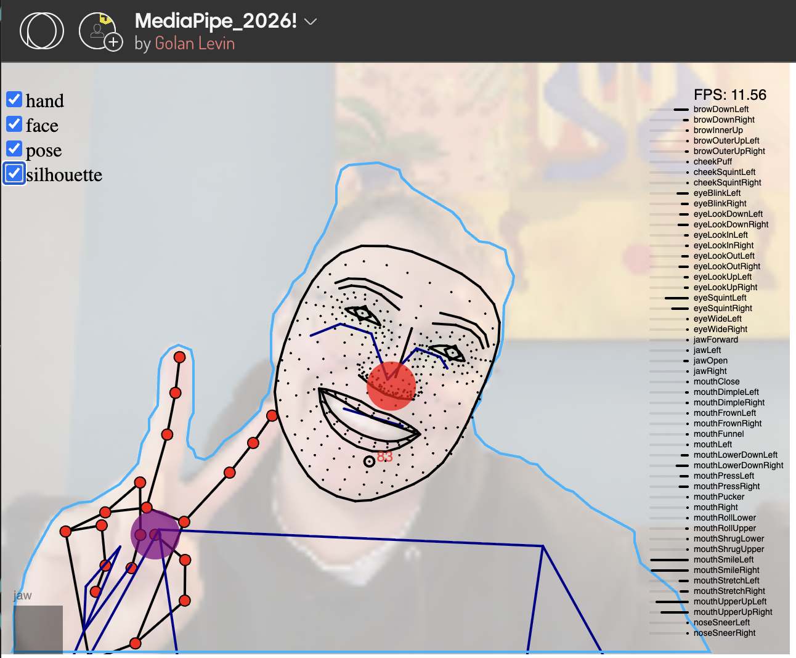
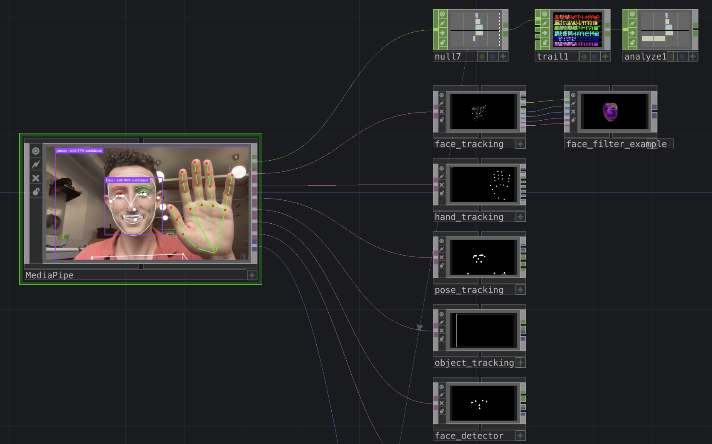
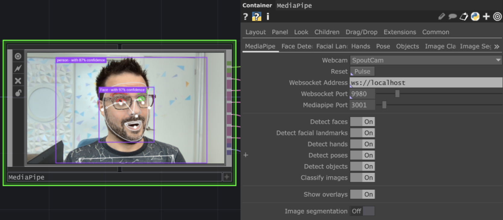
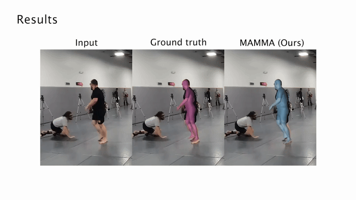
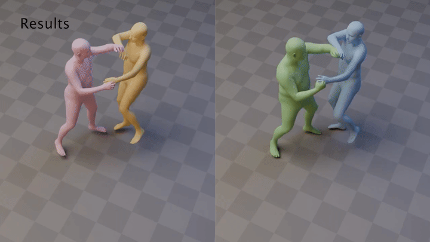

# Motion Capture on a Budget
By Nica Ross 2026

## Motion capture basics

The goal of motion capture is to capture and translate the physical position and movement of bodies or objects into digital space. Typically, this means representing joints or other significant physical points as a series of x, y, and z coordinates that change over time. Some systems also capture orientation: how a body part or object rotates.

For this demo, we’ll group motion capture systems into two broad categories:

* Body-mounted sensors or markers
* Markerless camera-based capture

### Body-mounted sensors or markers

These systems require attaching equipment to the body or object being tracked. There are two common approaches:

* **Optical marker tracking:** Specialized cameras track physical markers, often reflective markers illuminated with infrared light. Software uses multiple camera views to calculate the markers’ positions in 3D space. Example above: [Vicon](https://www.vicon.com/) 
*(note: you can use the Optitrak system in IDeATe if you would like to try this process)*
* **Wearable sensor tracking:** Sensors attached to the body measure acceleration and rotation. Software combines these measurements to estimate body movement. The data can be transmitted through wired connections, Bluetooth, or other wireless systems. Example above: [Rokoko](https://www.rokoko.com/)

These systems can provide detailed motion capture, but dedicated hardware can be expensive and requires fitting and calibration. Optical markers must remain visible to cameras. Wearable inertial sensors do not require camera visibility, but their estimated position can drift over time.

The price of these systems can range from $10,000 - $100,000. And require custom capture hardware, software and wearable sensors.

### Markerless camera-based capture

These systems use software to identify and estimate body positions from camera images without attaching sensors or markers to the performer. They can use ordinary webcams, phones, or video cameras, making motion capture more accessible with equipment you may already have and way more afforadable.

This demo focuses on two workflows:

* **MediaPipe:** Estimates body, hand, or facial landmarks from a single camera feed or recorded video. It can work in real time, making it useful for controlling visuals, triggering cues, and creating interactive responses to movement.
* **MAMMA:** Reconstructs 3D body movement from multiple synchronized camera recordings using a digital body model called SMPL-X. It requires camera calibration and processing after recording, making it useful for capturing movement to reuse in animation or other digital projects.

Both approaches reduce the need for specialized capture hardware, but they depend on the quality and visibility of the recorded movement. Lighting, camera placement, motion blur, and bodies obscuring one another can affect the results. MAMMA also requires more camera preparation and computing resources than a typical MediaPipe setup.

The key distinction for this demo is that **MediaPipe supports live(!) interaction, while MAMMA reconstructs recorded movement for later use.**

## MediaPipe

MediaPipe is an open-source framework developed by Google for building on-device machine-learning pipelines that process live and recorded media. Its [framework paper](https://arxiv.org/abs/1906.08172), with Camillo Lugaresi as lead author, was first shared as a research preprint in June 2019, when Google also presented the project and released its code at the IEEE/CVF Conference on Computer Vision and Pattern Recognition (CVPR) that month. MediaPipe now sits under Google AI Edge with a unified Tasks API that also covers text, audio and on-device LLM inference. 
ki-syndikat

MediaPipe’s Pose Landmarker detects landmarks of human bodies in an image or video, estimating 33 three-dimensional pose landmarks per person, again without sensors or markers. Unlike MAMMA, it works from **a single camera**, and it handles images, video files, and live video streams, so movement can be tracked in **real time** on an ordinary laptop or phone. Because processing happens locally, no images are sent to a server. The trade-off is detail: it produces a set of body keypoints rather than a full reconstruction of the body’s shape, and depth from a single view is an estimate.

[Check out Golan's mediapipe browser tool.](https://openprocessing.org/@golan/2760298)

### Touchdesigner
[The MediaPipe TouchDesigner plugin](https://github.com/torinmb/mediapipe-touchdesigner) is a free, open-source component created by Torin Blankensmith and Dom Scott. It was first released in summer 2023 and is distributed under the MIT license. It brings Google’s MediaPipe into TouchDesigner as a GPU-accelerated, self-contained plugin that runs on Mac and PC with no installation, and it supports every MediaPipe vision model except Interactive Segmentation and Image Embedding. 

The plugin works by running MediaPipe’s web version inside TouchDesigner. The main MediaPipe.tox launches an embedded Chromium browser that hosts all the vision tasks, and provides a DAT output for each task plus a TOP showing the video feed and overlays. The models and web page are stored in TouchDesigner’s virtual file system, so it runs without an internet connection, and results are sent back into TD over a local WebSocket server. Companion toxes for face, hands, pose, objects, segmentation and classification turn that JSON data into channels you can wire into the rest of a network.

**Important things to note:**

* Enable External .tox when dragging MediaPipe.tox into a new project. Without it, the .toe file size becomes massive. 
* Input is capped at 720p. 
* Turn off unused models. The detection tasks are heavy on CPU and GPU, so disable any you aren’t using. 
* Expect a few frames of lag. The browser component adds at least 3 frames of delay, and the totalInToOutDelay channel can drive a Cache TOP to resync your video. 
* Using video instead of a webcam takes a workaround. Send your TOP out with an NDI Out TOP, then use NDI Webcam (part of the free NDI Tools on Windows and Mac) to turn that stream into a virtual camera you can select in MediaPipe.

### Demo: Mediapipe in Touchdesigner

## MAMMA aka Markerless Accurate Multi-person Motion Acquisition ([link](https://mamma.is.tue.mpg.de/))

MAMMA (Markerless Accurate Multi-person Motion Acquisition) was developed by researchers at the Max Planck Institute for Intelligent Systems in Tübingen, Germany, and Carnegie Mellon University, with Hanz Cuevas Velasquez and Anastasios Yiannakidis as joint lead authors. First shared as a research preprint in June 2025, it was presented at the IEEE/CVF Conference on Computer Vision and Pattern Recognition (CVPR) in June 2026.

MAMMA estimates movement of people from synchronized videos recorded by multiple calibrated cameras, without requiring reflective markers or motion-capture suits. In our workflow it separates people from the images, predicts body landmarks, and fits moving 3D human bodies to the observations.

This process is a major update to motion capture due to it's ability to distinguish individual bodies even while they touch each other and when they are flat against the ground. Previous models relied on "typical" human movement and became confused when bodies entangled.

### MAMMA Requirements:
* A linux capable computer - We currently have MAMMA set up on Golan's PC laptop.
* A NVIDIA GPU
* You must create a login at both the MAMMA and [SMPL-X](https://smpl-x.is.tue.mpg.de/) websites to download their packages.
* Captured footage must follow these procedures:
	* Minimum of four cameras
	* Mounted on rigid and unmoving tripods
	* Full body shots of all action
	* Camera positions should represent multiple perspectives and not be in a line.
	* Camera lens, fps and resolutions should match
	* Calibrate using a ChArUco board [following this process](https://medium.com/@nflorent7/a-comprehensive-guide-to-camera-calibration-using-charuco-boards-and-opencv-for-perspective-9a0fa71ada5f)

### Demo 1: MAMMA viewer in browser

### Demo 2: MAMMA into Touchdesigner

### Demo 3: MAMMA into Blender

