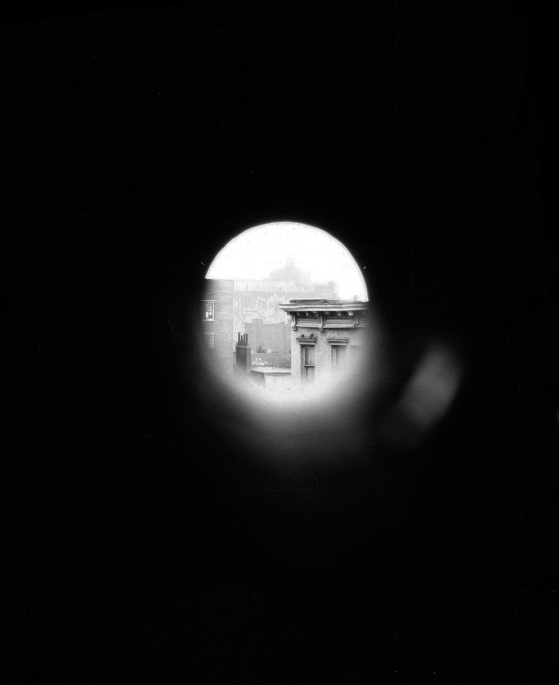
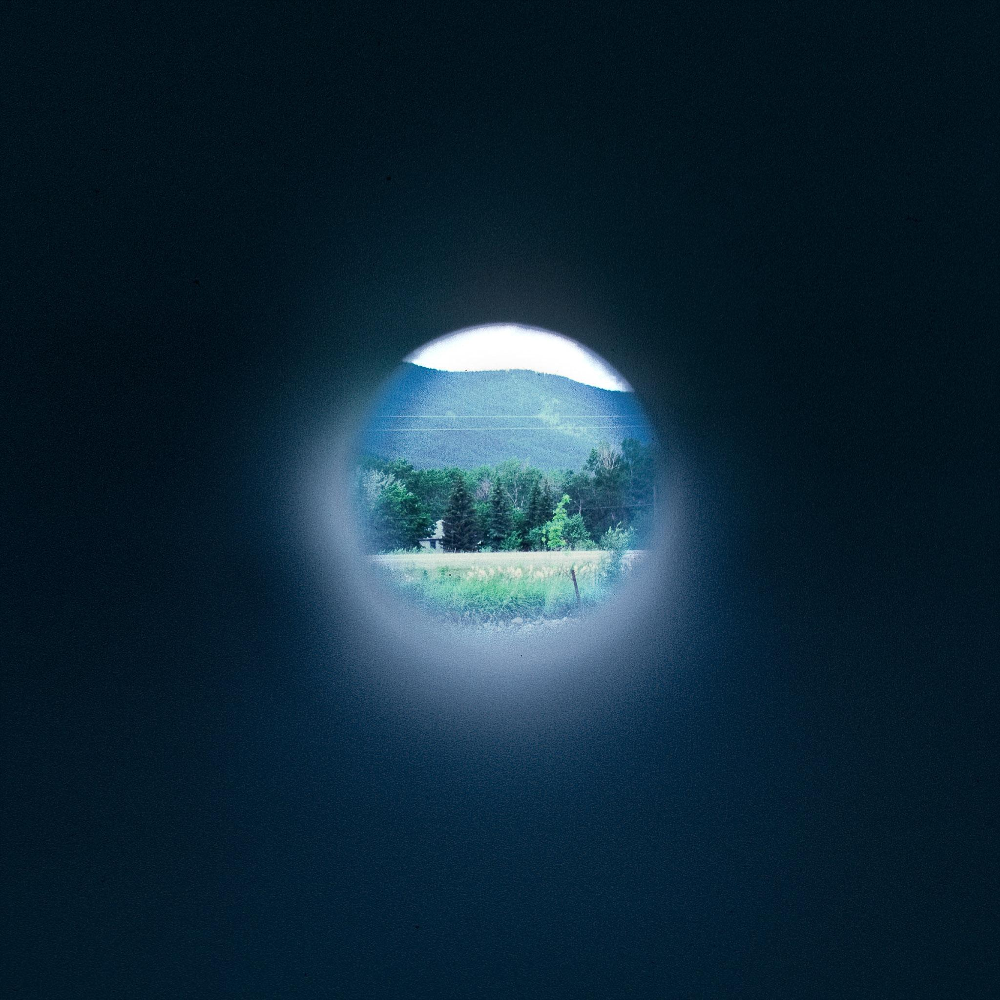
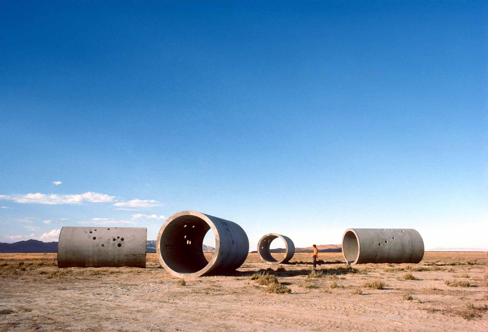
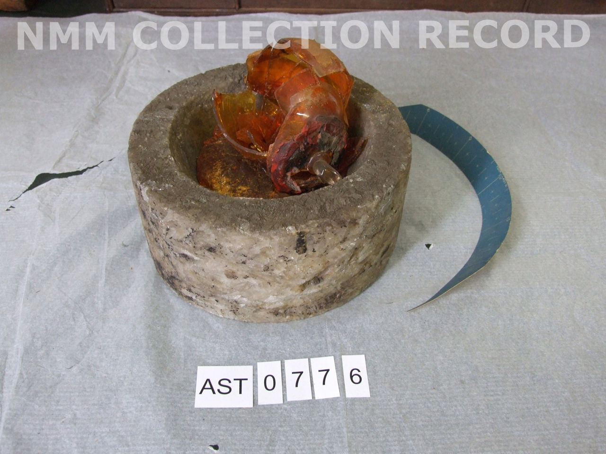
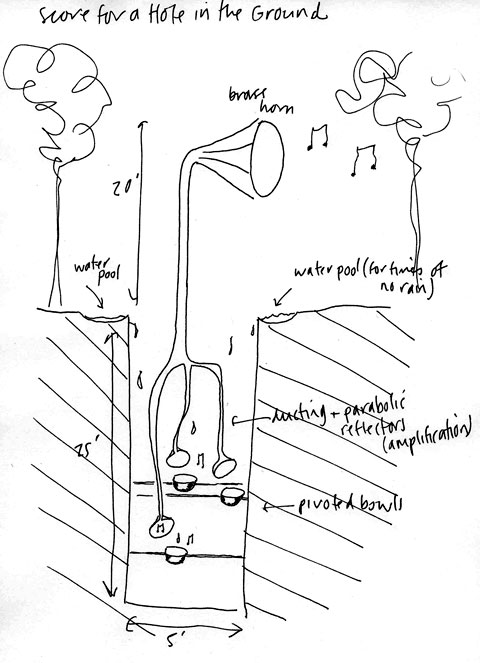
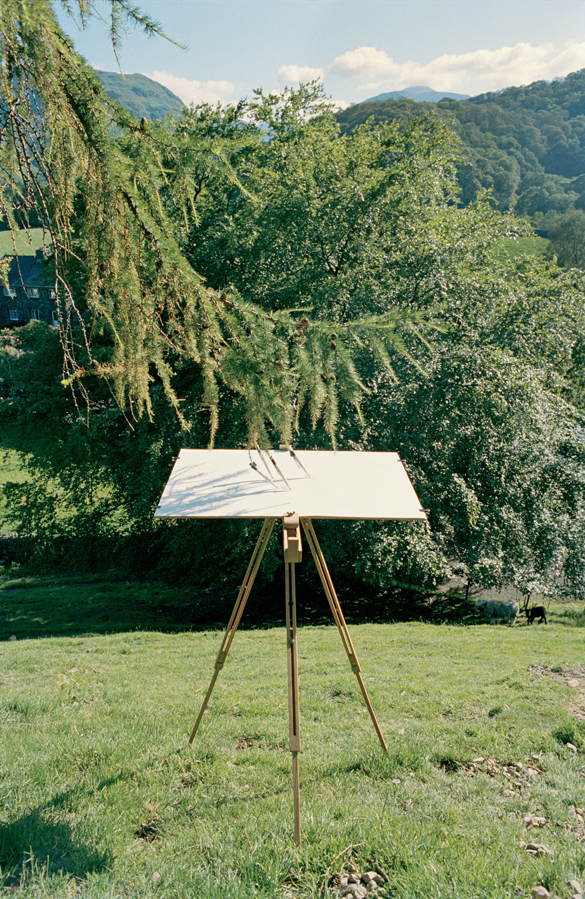
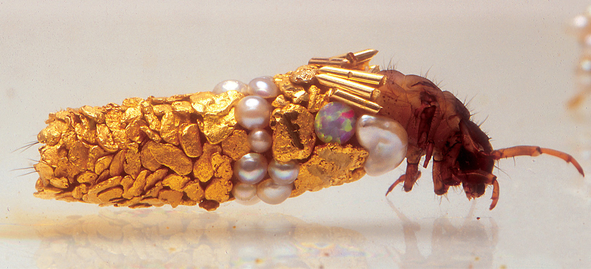
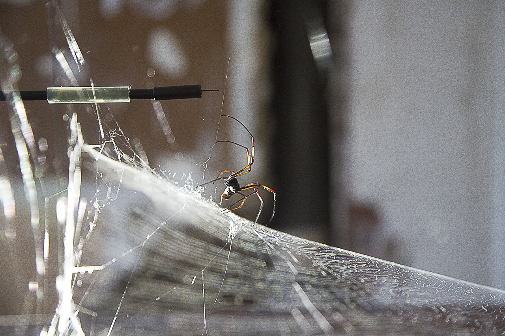

# Natural Captures (with a little help from a human)
*Compiled by Nica Ross*
 
---
 
# Light
 
## Nancy Holt — *Locator in Window* (1971)
 

 
*[Image source (Holt/Smithson Foundation)](https://holtsmithsonfoundation.org/node/664)*
 
A steel pipe viewing device set on the windowsill of Holt's Greenwich Street studio in New York, pointed at the city skyline. It is the first of her Studio Locators directed at the view outside.
 
---
 
## Nancy Holt — *Missoula Ranch Locators: Vision Encompassed* (1972)
 

 
*[Image source (Holt/Smithson Foundation)](https://holtsmithsonfoundation.org/node/711) · [Drawing](https://holtsmithsonfoundation.org/node/719) · [16mm film](https://holtsmithsonfoundation.org/node/722)*
 
Eight galvanized steel Locators set in a 40-foot circle on a ranch near Missoula, Montana, one for each compass direction. Each one frames a single view of the landscape, from 150 feet to ten miles away. The work was dismantled in 2003.
 
---
 
## Nancy Holt — *Sun Tunnels* (1973–76)
 

 
*[Image source (Holt/Smithson Foundation)](https://holtsmithsonfoundation.org/node/129) · [Dia Art Foundation](https://diaart.org/visit/visit/nancy-holt-sun-tunnels) · [Interior view (Digs)](https://digs.net/sculptural-sundial-in-utah/sun-tunnels)*
 
Four concrete tubes, each 18 feet long and 9 feet across, laid out in an X in Utah's Great Basin Desert and aligned with sunrise and sunset on the solstices. Holes in the tops of the tubes, drilled in the patterns of four constellations, cast spots of sunlight inside.
 
**[Watch: Dia film on *Sun Tunnels* (Smarthistory)](https://smarthistory.org/nancy-holt-sun-tunnels)**
 
---
 
## Solargraphy
 

 
*[Image source: Tarja Trygg, Helsinki, 2002 (Alternative Photography)](https://www.alternativephotography.com/solargraphy-catching-the-suns-path-pinhole-camera/) · [Eight-year solargraph, Bayfordbury Observatory (Colossal)](https://www.thisiscolossal.com/2020/12/longest-exposure-photograph/)*
 
A pinhole camera made from a beer can, loaded with photographic paper and left outside for months. The paper records every arc the sun makes across the sky, with gaps on cloudy days.
 
**[How to make one (Instructables)](https://instructables.com/Solargraphy)**
 
---
 
## Chris McCaw — *Sunburn* series (2003–ongoing)
 

 
*[Image source (NPR)](https://www.npr.org/sections/pictureshow/2010/11/10/131225919/sunburn) · [Yossi Milo Gallery](https://yossimilo.com/publications/14)*
 
Long exposures made with homemade large-format cameras loaded with gelatin silver paper. The lens focuses the sun so strongly that it burns its path through the paper. Each piece is a unique paper negative.
 
---
 
## Campbell–Stokes Sunshine Recorder (1853 / 1879)
 

 
*[Image source (Royal Museums Greenwich)](https://www.rmg.co.uk/collections/objects/rmgc-object-10938) · [Campbell's original bowl recorder (Science Museum)](https://blog.sciencemuseum.org.uk/measuring-sunshine/)*
 
A glass sphere that focuses sunlight onto a curved card, burning a line across it as the sun moves. The length of the burn records the day's hours of sunshine. John Francis Campbell invented it in 1853, and George Gabriel Stokes refined it in 1879.
 
---
 
## Jordan Sunshine Recorder (1885)
 

 
*[Image source (Science Museum Group)](https://collection.sciencemuseumgroup.org.uk/objects/co54693/jordan-photographic-sunshine-recorder-1884) · [Analog Weather](https://www.analogweather.com/-henry-j-green-jordan-sunshine-recorder.html)*
 
A dark brass drum with small pinholes, lined with cyanotype paper. Sunlight entering through the pinholes traces the sun's path across the paper over the day. It is the photographic counterpart to the Campbell–Stokes recorder.
 
---
 
## Charles Ross — *Sunlight Convergence/Solar Burn* (1971–72)
 

 
*[Image source (City Arts)](https://www.cityarts.org/ross) · [Wikipedia](https://en.wikipedia.org/wiki/Charles_Ross_(artist))*
 
Every day for a year, Ross placed a wooden plank under a large fixed lens, and the sun burned its path into the wood. The 366 planks were shown together at the John Weber Gallery in New York.
 
---
 
## Anna Atkins — *Photographs of British Algae: Cyanotype Impressions* (1843)
 

 
*[Image source (NYPL via Atlas Obscura)](https://atlasobscura.com/articles/these-beautiful-images-of-algae-were-the-first-photos-to-illustrate-any-book) · [The Met](https://metmuseum.org/art/collection/search/286656)*
 
Cyanotype photograms of algae, made by laying specimens directly on light-sensitive paper in the sun, with no camera. It is considered the first book illustrated with photographs.
 
---
 
# Weather
 
## Walter De Maria — *The Lightning Field* (1977)
 

 
*[Image source (Dia Art Foundation)](https://diaart.org/visit/visit/walter-de-maria-the-lightning-field) · [Center for Land Use Interpretation](https://clui.org/ludb/site/lightning-field)*
 
Four hundred stainless steel poles set in a grid one mile by one kilometer in the high desert of western New Mexico. The pointed tips form a level plane and sometimes attract lightning.
 
---
 
## Hans Haacke — *Condensation Cube* (1963–65)
 

 
*[Image source (MACBA)](https://www.macba.cat/en/node/26278) · [Generali Foundation](https://foundation.generali.at/en/collection/artworks/gf0003070000-2001-kondensationswuerfel)*
 
A sealed clear acrylic cube holding a small amount of water. Changes in the gallery's light and temperature make the water evaporate and condense into droplets that run down the walls.
 
---
 
## Andy Goldsworthy — *Rain Shadows* (1984–ongoing)
 

 
*[Image source (PBS NewsHour)](https://www.pbs.org/newshour/arts/watch-the-fleeting-beauty-of-artist-andy-goldsworthys-rain-shadows) · [Matthew Brown Gallery](https://matthewbrowngallery.com/exhibitions/andy-goldsworthy)*
 
Goldsworthy lies on the ground as rain begins and stays there until the surrounding surface is wet. When he stands up, a dry silhouette of his body remains until the rain fills it in.
 
**[Watch: PBS NewsHour video](https://www.pbs.org/newshour/arts/watch-the-fleeting-beauty-of-artist-andy-goldsworthys-rain-shadows)**
 
---
 
# Wind
 
## Aeolian Harps
 

 
*[Image source (Atlas Obscura)](https://www.atlasobscura.com/articles/3072) · [Britannica](https://britannica.com/EBchecked/topic/7164/Aeolian-harp)*
 
A string instrument played only by the wind. Air moving across the strings makes them vibrate and sound harmonics. Athanasius Kircher first described the instrument in 1650.
 
**[Listen (Organology)](https://organology.net/instrument/aeolian-harp)**
 
---
 
# Water and Ice
 
## Nancy Holt — *Hydra's Head* (1974)
 

 
*[Image source (Holt/Smithson Foundation)](https://holtsmithsonfoundation.org/node/252)*
 
Six concrete pools sunk level with the ground on the banks of the Niagara River at Artpark in Lewiston, New York. They are arranged in the pattern of the stars of the Hydra constellation and reflect the sky.
 
**[Watch: Holt, *Niagara* (1975), 16mm film](https://holtsmithsonfoundation.org/niagara)**
 
---
 
## Katie Paterson — *Vatnajökull (the sound of)* (2007–08)
 

 
*[Image source (Katie Paterson)](https://katiepaterson.org/?p=198) · [PKM Gallery](https://pkmgallery.com/exhibitions/katie-paterson/selected-works)*
 
A live phone line to an Icelandic glacier, made with an underwater microphone in Jökulsárlón lagoon. Anyone could call 07757001122 and hear the glacier melting.
 
**[Listen (NPR)](https://www.npr.org/2007/07/29/12317438/artist-records-glaciers-sounds-from-the-deep)**
 
---
 
## Katie Paterson — *Langjökull, Snæfellsjökull, Sólheimajökull* (2007)
 

 
*[Image source (Inhabitat)](https://inhabitat.com/ice-records-play-the-songs-of-melting-glaciers/)*
 
Three records cast in ice made from the meltwater of three Icelandic glaciers, each carrying a recording of its glacier's sounds. The records were played on turntables until they melted.
 
---
 
## Olafur Eliasson — Glacial ice watercolours (2016–ongoing)
 

 
*[Image source (Studio Olafur Eliasson)](https://olafureliasson.net/artwork/glacial-currents-yellow-sienna-2018/) · [Beyond human time](https://olafureliasson.net/artwork/beyond-human-time-2020/)*
 
Pieces of Greenlandic glacial ice placed on paper over washes of pigment. As the ice melts, the meltwater moves the pigment and forms the image.
 
---
 
## Jana Winderen — Hydrophone recordings (2005–ongoing)
 

 
*[Image source (Slowdown)](https://www.slowdown.media/article/the-art-of-listening-under-water-jana-winderen)*
 
Recordings made with hydrophones and ultrasound detectors under sea ice, inside glacier crevasses, in fjords, and in the deep ocean.
 
**[Listen: *Energy Field*](https://janawinderen.com/releases/energy-field)**
 
---
 
## Jem Finer — *Score for a Hole in the Ground* (2006)
 

 
*[Image source (Sculpture Magazine)](https://sculpturemagazine.art/score-for-a-hole-in-the-ground-a-conversation-with-jen-finer/) · [PRS Foundation](https://prsfoundation.com/?p=4920)*
 
A sound sculpture sunk into a forest in Kent, England. Water drips down a seven-meter shaft onto tuned steel bowls and blades, and a large steel horn carries the sound up into the woods.
 
**[Watch (Coilhouse)](https://coilhouse.net/?p=9719)**
 
---
 
# Trees and Wood
 
## Tim Knowles — *Tree Drawings* (2005–ongoing)
 

 
*[Image source (Cabinet Magazine)](https://www.cabinetmagazine.org/issues/28/knowles.php)*
 
Pens attached to the tips of tree branches draw on paper set up nearby as the wind moves the branches.
 
**[Watch (Vimeo)](https://vimeo.com/37331908)**
 
---
 
## David Nash — *Wooden Boulder* (1978–ongoing)
 

 
*[Image source (Christie's)](https://www.christies.com/en/stories/david-nash-on-his-free-range-sculpture-wooden-boulder-16159844456e4957b5b14e87f6d3a9e7) · [Pruned](https://pruned.blogspot.com/2008/04/25-year-riverine-journey-of-wooden.html)*
 
A half-ton sphere carved from an oak in North Wales and left in a stream. Over decades, floods and tides carried it down the River Dwyryd to the estuary, where it was last seen in 2015.
 
---
 
# Earth
 
## herman de vries — *from earth: everywhere* (2014–15)
 

 
*[Image source (herman de vries catalogue)](https://www.hermandevries.org/digital-catalogue/2015/2015-00-00-0500.php) · [frieze](https://frieze.com/article/one-take-whole-earth)*
 
Soil samples collected from sites around the world, each rubbed by hand onto paper. The color of each sheet comes from the earth of its place.
 
---
 
# Animals
 
## Hubert Duprat — Caddisfly larvae (1980–ongoing)
 

 
*[Image source (Cabinet Magazine)](https://cabinetmagazine.org/issues/25/duprat.php) · [Leonardo](https://leonardo.info/gallery/gallery314/duprat.html)*
 
Caddisfly larvae, given gold flakes, pearls, and precious stones in place of the sand and twigs they normally use, build their protective cases from them.
 
---
 
## Tomás Saraceno — *Arachnid Orchestra. Jam Sessions* (2015)
 

 
*[Image source (e-flux)](https://www.e-flux.com/announcements/2470/tom-s-saracenoarachnid-orchestra-jam-sessions) · [Arachnophilia](https://arachnophilia.net/?p=17)*
 
Spider webs used as instruments. The vibrations spiders make on their webs are amplified so people can hear them, and musicians perform with the spiders live.
 
**[Listen (NTU CCA Singapore)](https://ntu.ccasingapore.org/publications/tomas-saraceno-arachnid-orchestra-jam-sessions/)**
 
---
 
## Bernie Krause — *The Great Animal Orchestra* (2016)
 

 
*[Image source (Hyperallergic)](https://hyperallergic.com/bernie-krause-great-animal-orchestra)*
 
An immersive installation, made with United Visual Artists, built from decades of wild soundscape recordings. Krause's archive includes recordings of California's Lincoln Meadow made before and after selective logging.
 
**[Listen: Lincoln Meadow before and after logging](https://beside.media/listening-to-the-great-animal-choir/)**