# Natural Captures (with a little help from a human)
*Compiled by Nica Ross*
 
---
 
# Light
 
## Nancy Holt — *Locator in Window* (1971)

Nancy Holt (1938–2014) was an American artist and a formative artist in the practice of Land art. She worked in sculpture, film, photography, concrete poetry and installation. Her work is about perception: she built devices and sites that frame how we see a landscape and how the sun and stars move across it. 
 

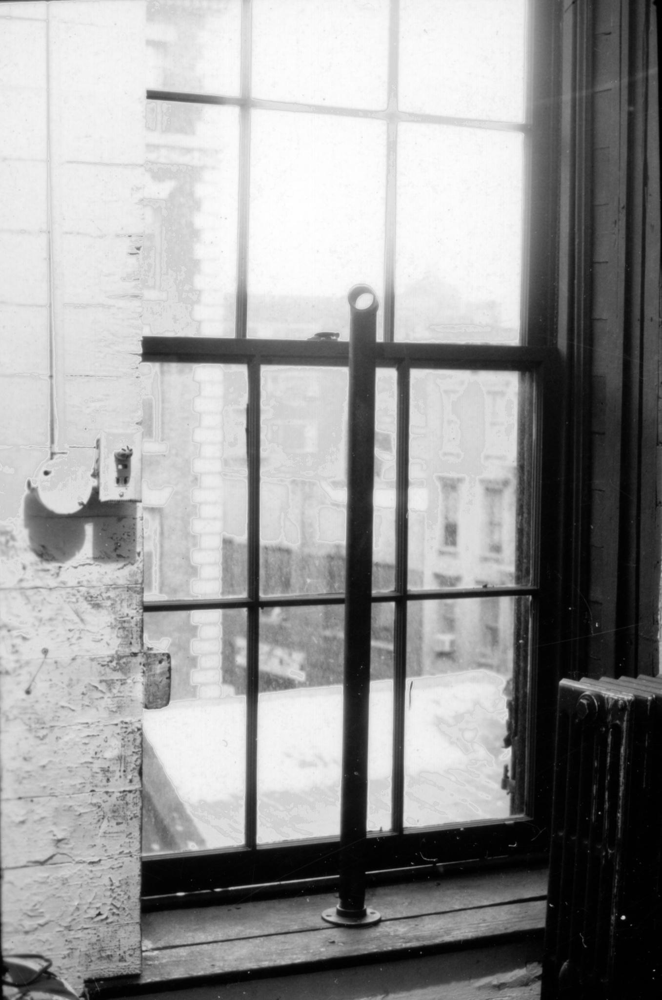
 
*[Image source (Holt/Smithson Foundation)](https://holtsmithsonfoundation.org/node/664)*
 
A steel pipe viewing device set on the windowsill of Holt's Greenwich Street studio in New York, pointed at the city skyline. It is the first of her Studio Locators directed at the view outside.
 
---
 
## Nancy Holt — *Missoula Ranch Locators: Vision Encompassed* (1972)

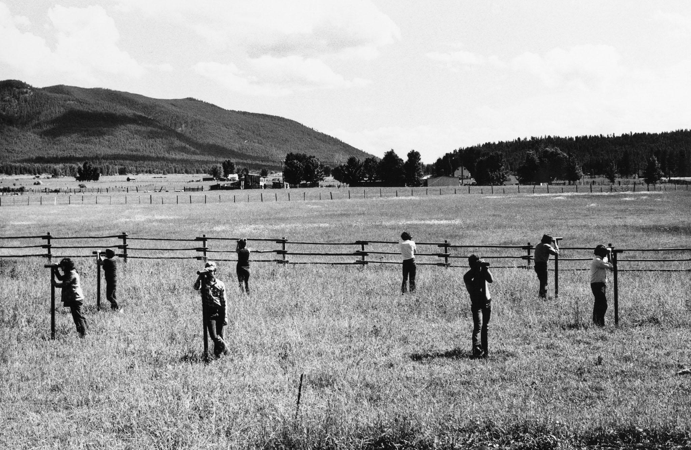 

*[Image source (Holt/Smithson Foundation)](https://holtsmithsonfoundation.org/node/711) · [Drawing](https://holtsmithsonfoundation.org/node/719) · [16mm film](https://holtsmithsonfoundation.org/node/722)*
 
Eight galvanized steel Locators set in a 40-foot circle on a ranch near Missoula, Montana, one for each compass direction. Each one frames a single view of the landscape, from 150 feet to ten miles away. The work was dismantled in 2003.
 
---
 
## Nancy Holt — *Sun Tunnels* (1973–76)
 

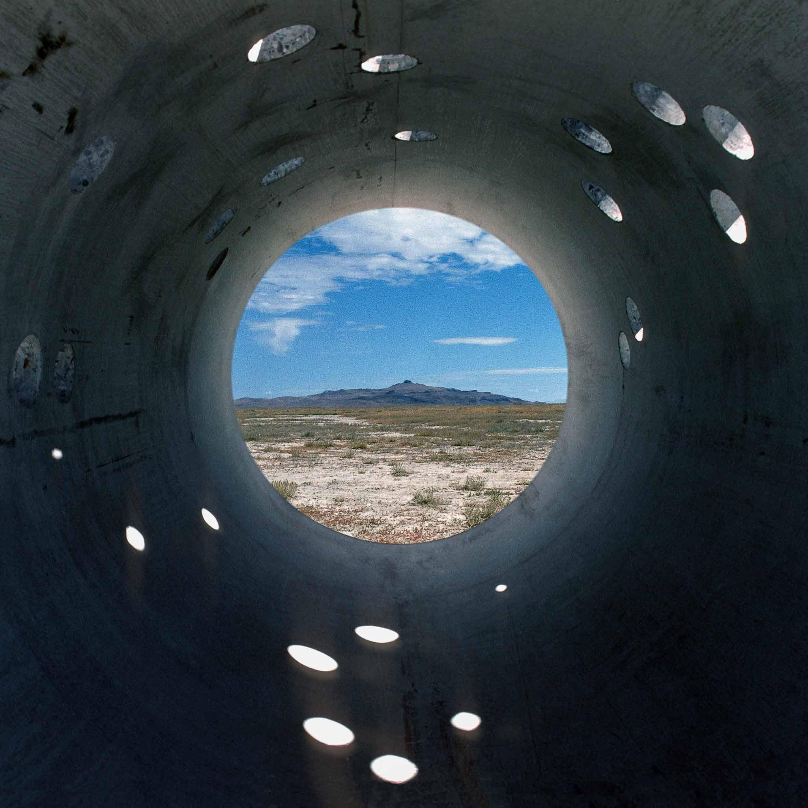
 
*[Image source (Holt/Smithson Foundation)](https://holtsmithsonfoundation.org/node/129) · [Dia Art Foundation](https://diaart.org/visit/visit/nancy-holt-sun-tunnels) · [Interior view (Digs)](https://digs.net/sculptural-sundial-in-utah/sun-tunnels)*
 
Four concrete tubes, each 18 feet long and 9 feet across, laid out in an X in Utah's Great Basin Desert and aligned with sunrise and sunset on the solstices. Holes in the tops of the tubes, drilled in the patterns of four constellations, cast spots of sunlight inside.
 
**[Watch: Dia film on *Sun Tunnels* (Smarthistory)](https://smarthistory.org/nancy-holt-sun-tunnels)**
 
---
 
## Solargraphy
 
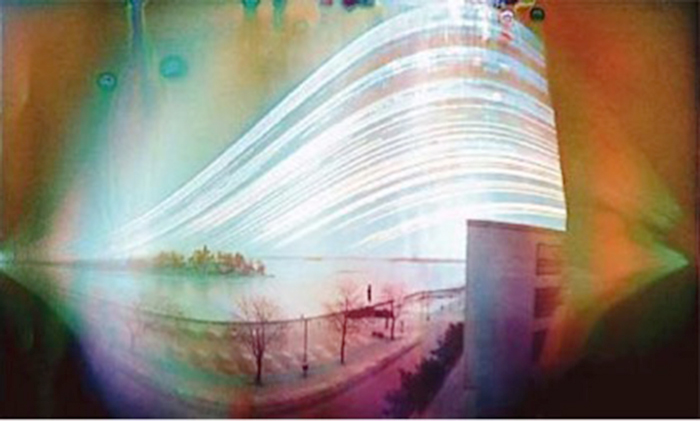

This solargraph is the result of a six-months exposure with a self-built pinhole camera located on a balcony in Helsinki, in 2002. Solargraph by Tarja Trygg

Tarja Trygg is a Finnish artist who did much to spread solargraphy. From 2006 to 2012 she ran an international project that mailed pinhole cameras to volunteers at different latitudes to record how the sun’s path changes across the globe.
 
*[Image source: Tarja Trygg, Helsinki, 2002 (Alternative Photography)](https://www.alternativephotography.com/solargraphy-catching-the-suns-path-pinhole-camera/) · [Eight-year solargraph, Bayfordbury Observatory (Colossal)](https://www.thisiscolossal.com/2020/12/longest-exposure-photograph/)*
 
A pinhole camera made from a beer can, loaded with photographic paper and left outside for months. The paper records every arc the sun makes across the sky, with gaps on cloudy days.
 
**[How to make one (Instructables)](https://instructables.com/Solargraphy)**
 
---
 
## Chris McCaw — *Sunburn* series (2003–ongoing)
 
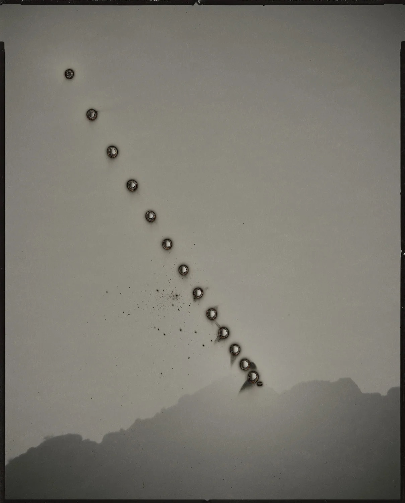
 
 Chris McCaw (b. 1971) is a San Francisco photographer who came to photography through skateboarding, zines and punk. He builds his own large-format cameras. Since an accidental all-night exposure in 2003, his work has let the sun physically mark and burn the paper.
 
*[Image source personal website](https://www.chrismccaw.com/sunburn)* 
 
Long exposures made with homemade large-format cameras loaded with gelatin silver paper. The lens focuses the sun so strongly that it burns its path through the paper. Each piece is a unique paper negative.
 
---
 
## Campbell–Stokes Sunshine Recorder (1853 / 1879)
 
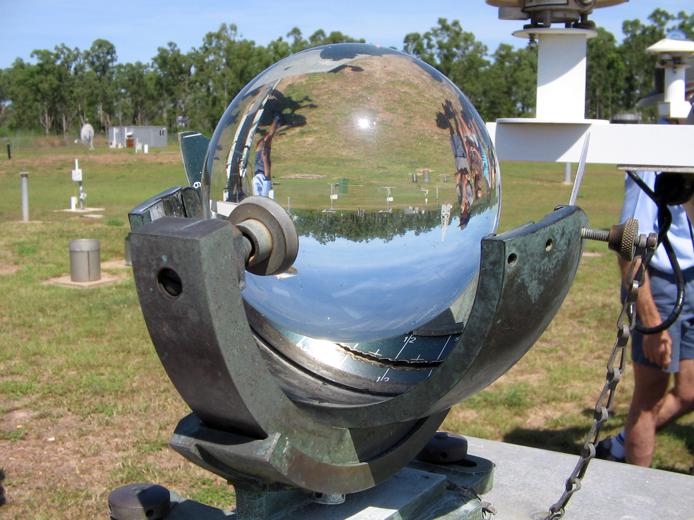
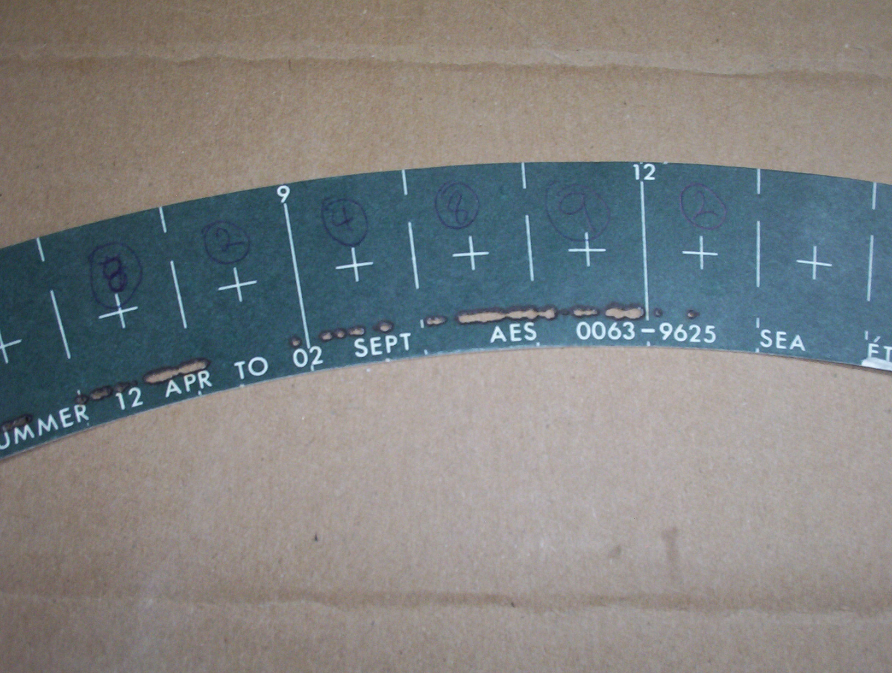
 
*[Campbell Stokes recorder and card (Wikipedia)](https://en.wikipedia.org/wiki/Campbell%E2%80%93Stokes_recorder#/media/File:Campbell-Stokes_recorder.jpg)*
 
A glass sphere that focuses sunlight onto a curved card, burning a line across it as the sun moves. The length of the burn records the day's hours of sunshine. John Francis Campbell invented it in 1853, and George Gabriel Stokes refined it in 1879.
 
---
 
## Jordan Sunshine Recorder (1885)
 

 
*[Image source (wikipedia](https://en.wikipedia.org/wiki/Jordan_sunshine_recorder)*
 
A dark brass drum with small pinholes, lined with cyanotype paper. Sunlight entering through the pinholes traces the sun's path across the paper over the day. It is the photographic counterpart to the Campbell–Stokes recorder.
 
---
 
## Charles Ross — *Year of Solar Burns* (1971–72)
 
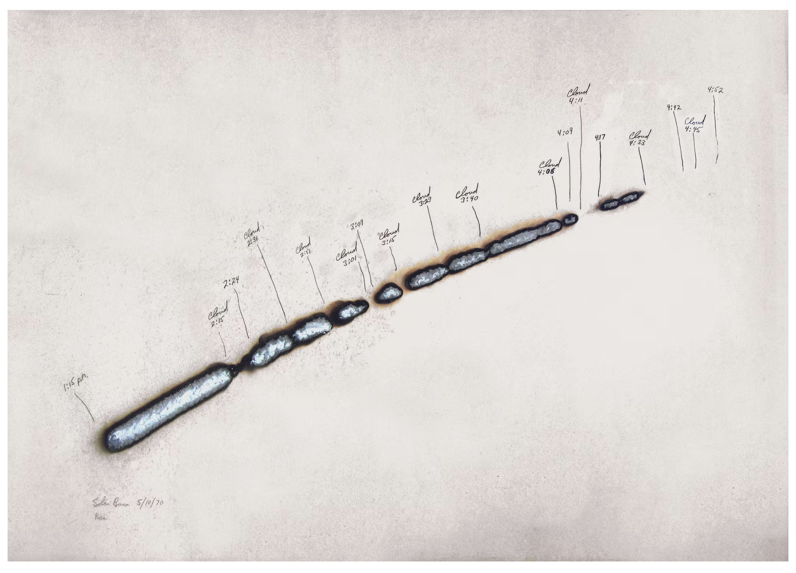
1970
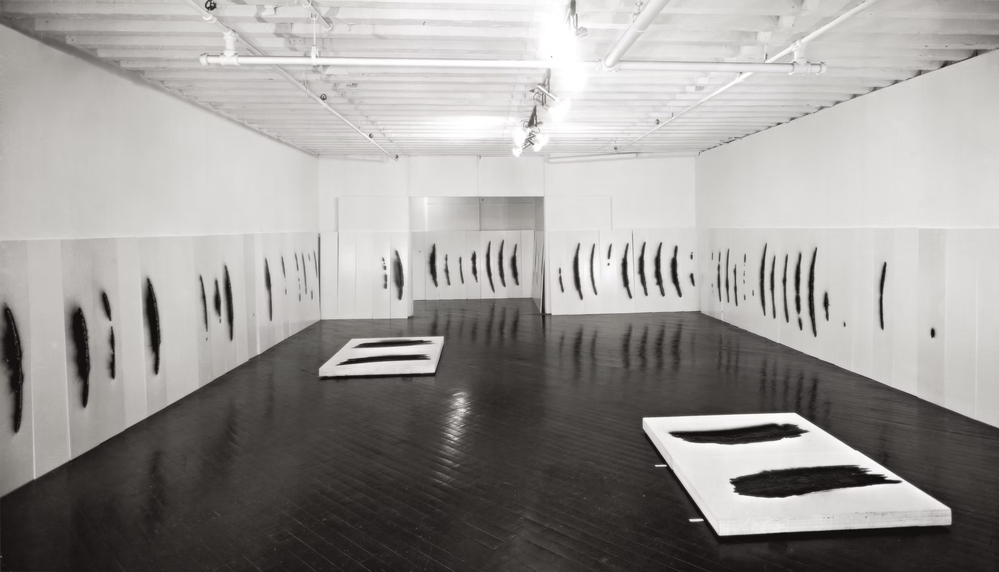
1971, John Weber Gallery
 
Charles Ross (b. 1937) is an American artist who began his practice in the 1960s and works directly with sunlight and starlight: prism installations that cast spectrums into buildings, solar burns, and Star Axis, a naked-eye observatory he has been building in New Mexico since 1971.
 
*[Image source (City Arts)](https://www.cityarts.org/ross) · [Wikipedia](https://en.wikipedia.org/wiki/Charles_Ross_(artist))*
 
Every day for a year, Ross placed a wooden plank under a large fixed lens, and the sun burned its path into the wood. The 366 planks were shown together at the John Weber Gallery in New York.
 
---
 
## Anna Atkins — *Photographs of British Algae: Cyanotype Impressions* (1843)
 
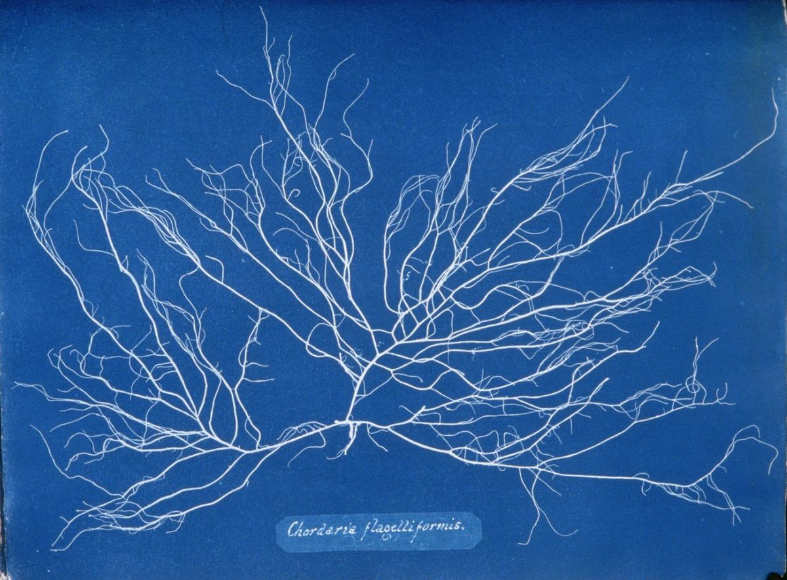
 
*[Image source (NYPL via Atlas Obscura)](https://atlasobscura.com/articles/these-beautiful-images-of-algae-were-the-first-photos-to-illustrate-any-book)*
 
Cyanotype photograms of algae, made by laying specimens directly on light-sensitive paper in the sun, with no camera. It is considered the first book illustrated with photographs.

Anna Atkins (1799–1871) was an English botanist, encouraged in science by her father, the scientist John George Children. Through her circle, which included John Herschel and William Henry Fox Talbot, she learned early photographic processes. She used cyanotype to record plants without a camera.
 
---
 
# Weather
 
## Walter De Maria — *The Lightning Field* (1977)
 
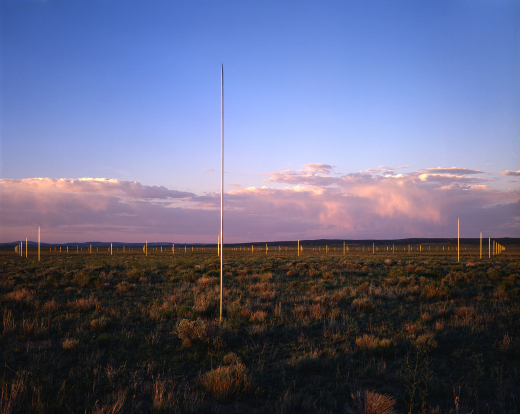
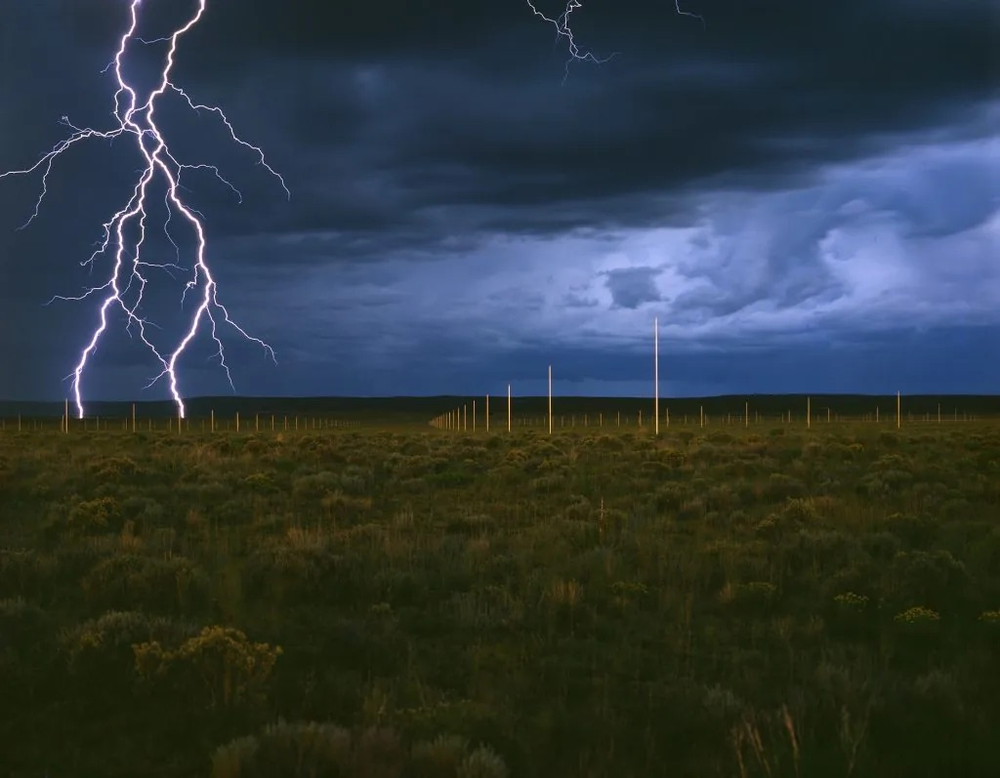
 
*[Image source (Dia Art Foundation)](https://diaart.org/visit/visit/walter-de-maria-the-lightning-field) · [Artnet](https://news.artnet.com/art-world/the-lightning-field-2494354)*
 
Four hundred stainless steel poles set in a grid one mile by one kilometer in the high desert of western New Mexico. The pointed tips form a level plane and sometimes attract lightning.

Walter De Maria (1935–2013) was an American sculptor, born in California, who moved to New York in 1960 and became central to Minimalism and Land art. His major works for Dia Art Foundation, including The New York Earth Room and The Lightning Field, treat earth, distance and natural events as sculptural material.
 
---
 
## Hans Haacke — *Condensation Cube* (1963–65)
 
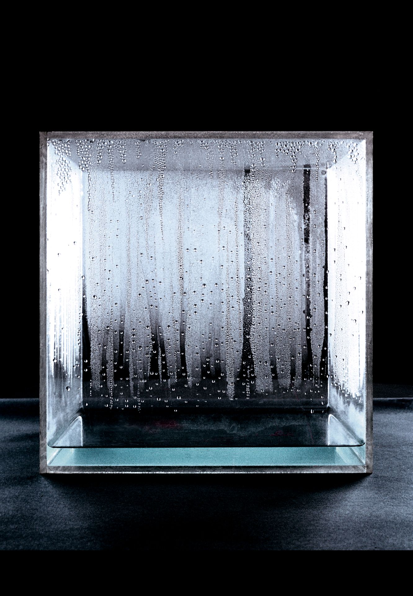
 
*[Image source (MACBA)](https://www.macba.cat/en/obra/r1523-condensation-cube/) · [Generali Foundation](https://foundation.generali.at/en/collection/artworks/gf0003070000-2001-kondensationswuerfel)*
 
A sealed clear acrylic cube holding a small amount of water. Changes in the gallery's light and temperature make the water evaporate and condense into droplets that run down the walls.
 
Hans Haacke (b. 1936) is a German-born artist who has lived in New York since the 1960s. His early “systems” works, linked to the ZERO group, used water, wind, plants and animals as living processes rather than fixed objects. He later applied the same systems thinking to museums, money and power, becoming a leading figure in institutional critique.
 
---
 
# Water and Ice
 
## Nancy Holt — *Hydra's Head* (1974)
 
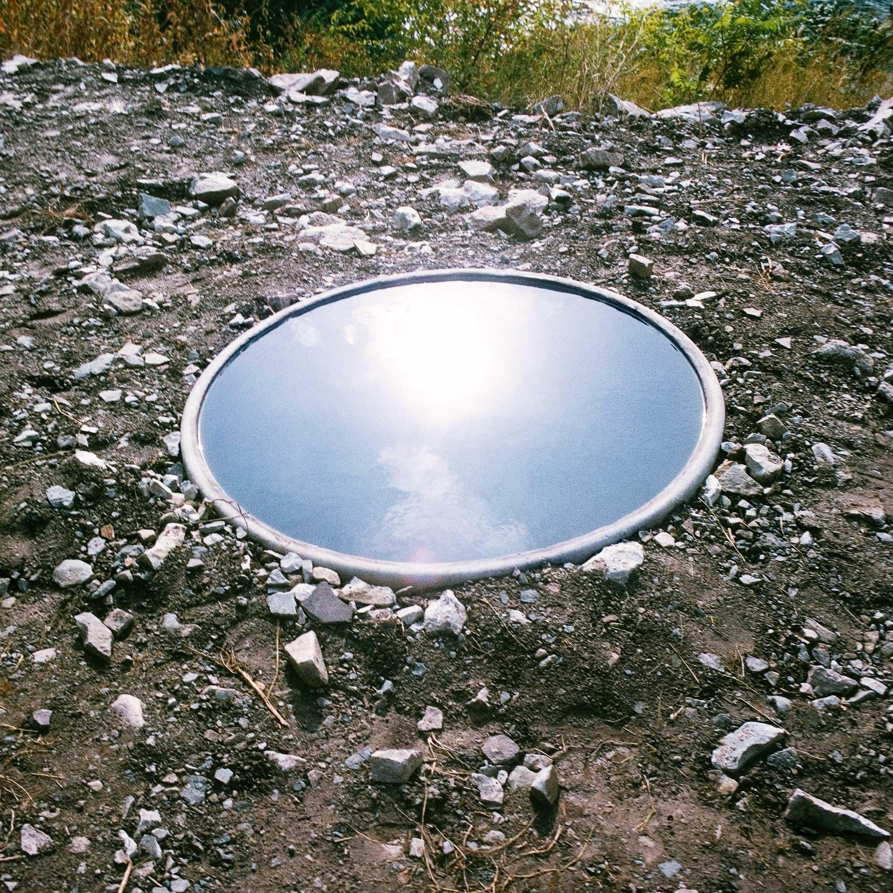
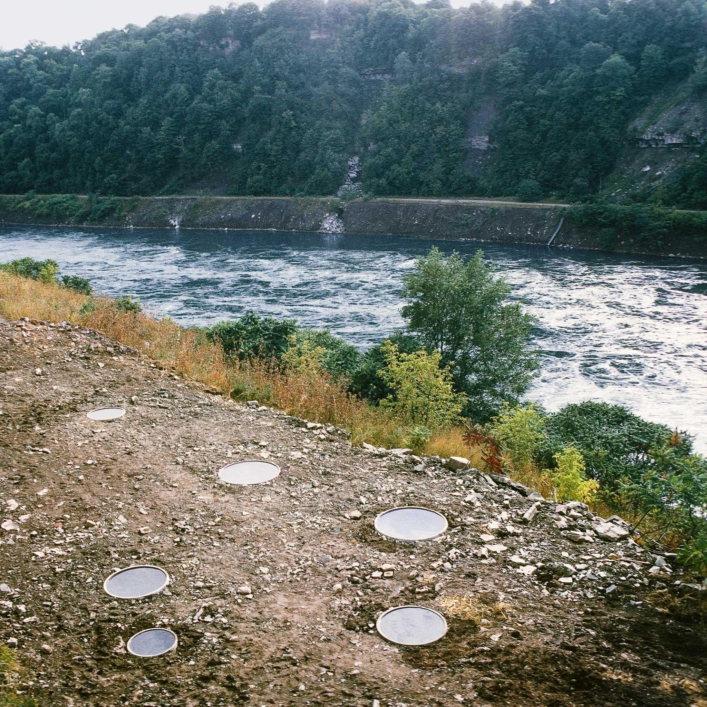
 
*[Image source (Holt/Smithson Foundation)](https://holtsmithsonfoundation.org/node/252)*
 
Six concrete pools sunk level with the ground on the banks of the Niagara River at Artpark in Lewiston, New York. They are arranged in the pattern of the stars of the Hydra constellation and reflect the sky.

 
---
 
## Katie Paterson — *Vatnajökull (the sound of)* (2007–08)
 
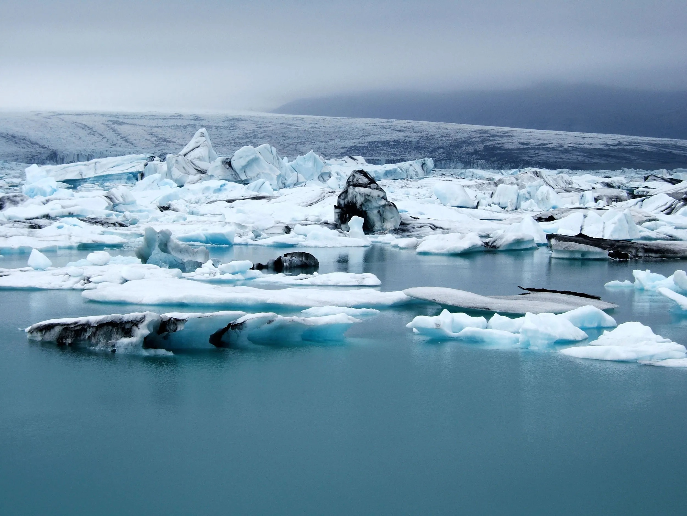
 
*[Image source (Katie Paterson)](https://katiepaterson.org/?p=198) · [PKM Gallery](https://pkmgallery.com/exhibitions/katie-paterson/selected-works)*
 
A live phone line to an Icelandic glacier, made with an underwater microphone in Jökulsárlón lagoon. Anyone could call 07757001122 and hear the glacier melting.

Katie Paterson (b. 1981) is a Scottish artist who works with scientists to make deep time and huge distances perceptible: glaciers, starlight, moonlight and the history of the universe. Her glacier works were among her first pieces, made while she was still a student.
 
**[Listen (NPR)](https://www.npr.org/2007/07/29/12317438/artist-records-glaciers-sounds-from-the-deep)**
 
---
 
## Olafur Eliasson — Glacial Currents and Beyond Human Time (2016–ongoing)
 
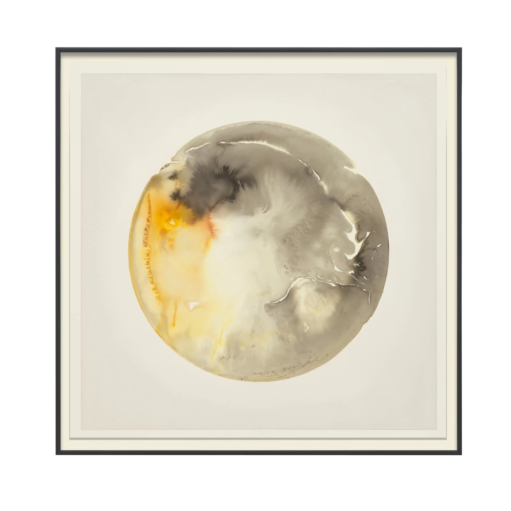
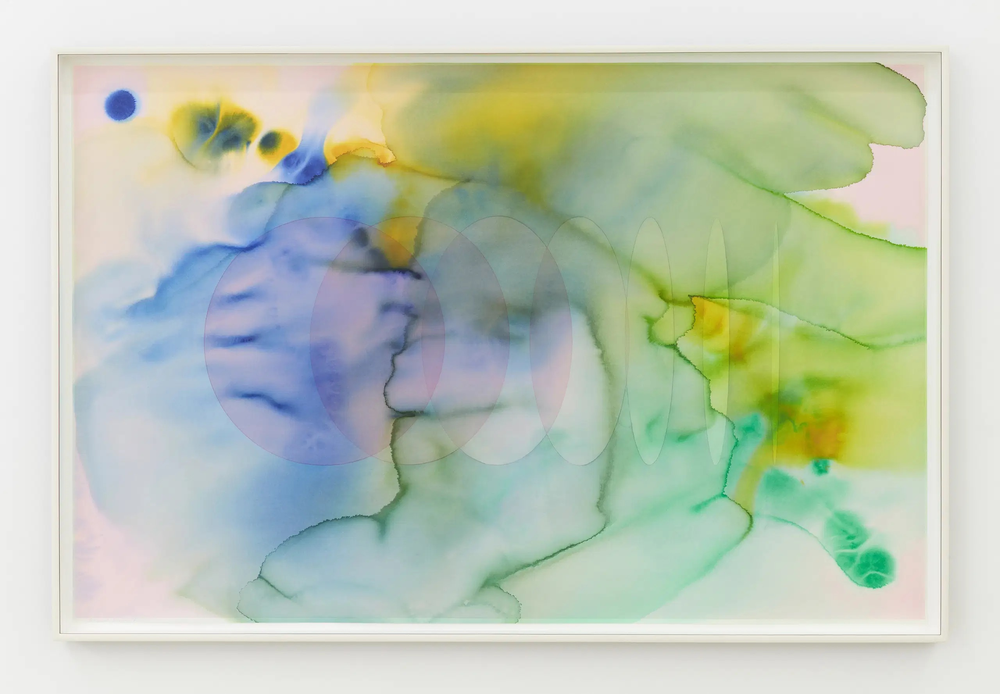
 
*[Image source (Studio Olafur Eliasson)](https://olafureliasson.net/artwork/glacial-currents-yellow-sienna-2018/) · [Beyond human time](https://olafureliasson.net/artwork/beyond-human-time-2020/)*
 
Pieces of Greenlandic glacial ice placed on paper over washes of pigment. As the ice melts, the meltwater moves the pigment and forms the image.

Olafur Eliasson (b. 1967) is a Danish-Icelandic artist with a large studio in Berlin. He is known for installations built from natural phenomena such as light, water, fog and ice, including The weather project at Tate Modern (2003) and Ice Watch, made with geologist Minik Rosing.
 
---
 
## Jana Winderen — Hydrophone recordings "Energy Field" (2005–ongoing)
 
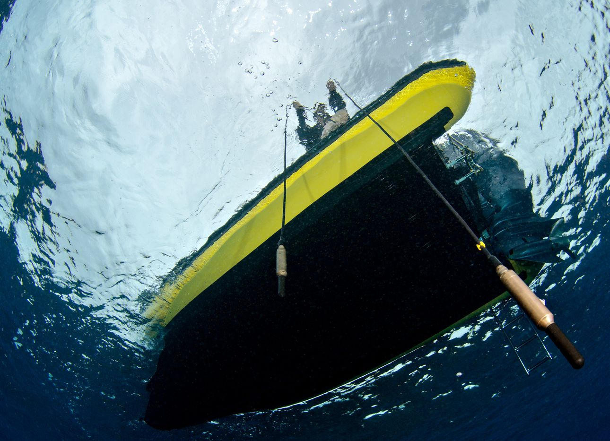
 
*[Image source (Slowdown)](https://www.slowdown.media/article/the-art-of-listening-under-water-jana-winderen)*
 
Recordings made with hydrophones and ultrasound detectors under sea ice, inside glacier crevasses, in fjords, and in the deep ocean.

Jana Winderen is a Norwegian artist trained in fine art at Goldsmiths, with a background in mathematics, chemistry and fish ecology. She uses hydrophones and ultrasound detectors to record sounds people can’t normally hear, from oceans, ice and glaciers, and presents them as compositions and multichannel installations.
 
**[Listen: *Energy Field*](https://janawinderen.bandcamp.com/album/energy-field)**
 
---
 
# Trees and Wood
 
## Tim Knowles — *Tree Drawings* (2005–ongoing)
 

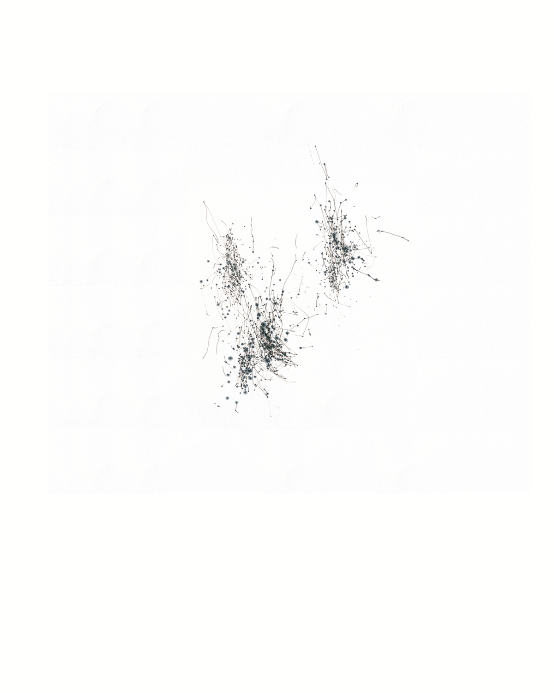
 
*[Image source (Cabinet Magazine)](https://www.cabinetmagazine.org/issues/28/knowles.php)*
 
Pens attached to the tips of tree branches draw on paper set up nearby as the wind moves the branches.

Tim Knowles is an artist based in London. His work has been included in numerous exhibitions in the UK and abroad, including the Jerwood Drawing Prize and the Hayward Gallery touring exhibition You’ll Never Know. In 2007, he completed a series of new works in collaboration with the Royal Mail. He has been commissioned by the Contemporary Art Society and the Economist to produce a new work for the Economist Plaza in February 2008.
 
**[Watch (Vimeo)](https://vimeo.com/37331908)**
 
---
 
# Earth
 
## herman de vries — *from earth: everywhere* (2014–15)
 
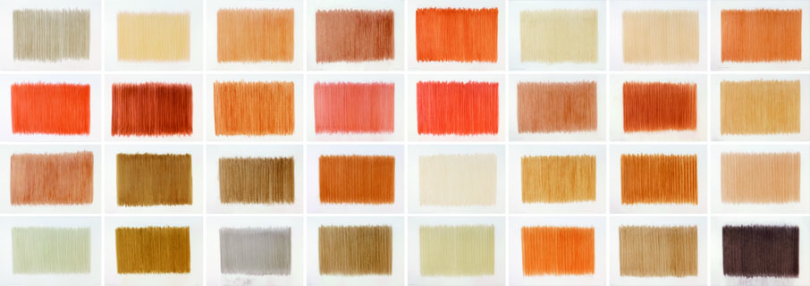
 
*[Image source (herman de vries catalogue)](https://www.hermandevries.org/digital-catalogue/2015/2015-00-00-0500.php)*
 
Soil samples collected from sites around the world, each rubbed by hand onto paper. The color of each sheet comes from the earth of its place.

herman de vries (b. 1931) is a Dutch artist trained in horticulture who worked as a plant scientist before devoting himself to art. Linked early on to the ZERO movement, he lives in Eschenau, Germany, and collects and presents natural materials as found: soil, plants and stones. He represented the Netherlands at the 2015 Venice Biennale.
 
---
 
# Animals
 
## Hubert Duprat — Caddisfly larvae (1980–ongoing)
 

 
*[Image source (Cabinet Magazine)](https://cabinetmagazine.org/issues/25/duprat.php) · [Leonardo](https://leonardo.info/gallery/gallery314/duprat.html)*
 
Caddisfly larvae, given gold flakes, pearls, and precious stones in place of the sand and twigs they normally use, build their protective cases from them.

Hubert Duprat (b. 1957) is a French artist and naturalist interested in where organic processes meet human-made materials, and in the tradition of the cabinet of curiosities. Since the early 1980s he has collaborated with caddisfly larvae, setting up conditions for the insects to make the work.
 
---
 
## Tomás Saraceno — *Arachnid Orchestra. Jam Sessions* (2015)
 

 
*[Image source (e-flux)](https://www.e-flux.com/announcements/2470/tom-s-saracenoarachnid-orchestra-jam-sessions)*
 
Spider webs used as instruments. The vibrations spiders make on their webs are amplified so people can hear them, and musicians perform with the spiders live.

Tomás Saraceno (b. 1973) is an Argentine artist, trained as an architect and based in Berlin. He works across art, architecture and science on ways of living with other species and the atmosphere. Through his long-running spider research, Arachnophilia, he treats spiders and their webs as collaborators and as instruments for sensing vibration.
 
**[Listen (youtube)](https://www.youtube.com/watch?v=hIuNu-dcQX8)** 
**[Concert (vimeo)](https://vimeo.com/471318444)**
 
---
